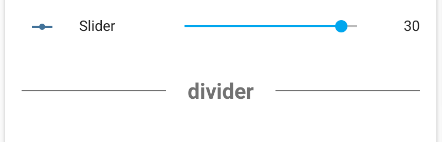
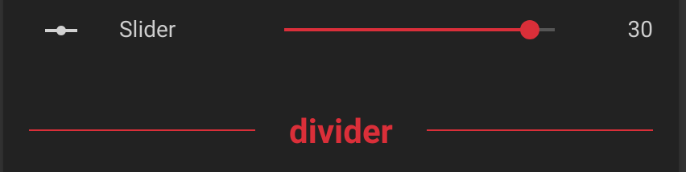

# 🗂 Text Divider Row

This card is for [Lovelace](https://www.home-assistant.io/lovelace) on [Home Assistant](https://www.home-assistant.io/) to display a text divider, as an entities card row or as a standalone card

[![GitHub Release][releases-shield]][releases]
[![License][license-shield]](LICENSE.md)
[](https://github.com/hacs/integration)

![Project Maintenance][maintenance-shield]
[![GitHub Activity][commits-shield]][commits]

[![Discord][discord-shield]][discord]
[![Community Forum][forum-shield]][forum]

[![Twitter][twitter]][twitter]
[![Github][github]][github]

## Support

Hey dude! Help me out for a couple of :beers: or a :coffee:!

[](https://www.buymeacoffee.com/zJtVxUAgH)

## Installation

Use [HACS](https://hacs.xyz) or follow this [guide](https://github.com/thomasloven/hass-config/wiki/Lovelace-Plugins)

```yaml
resources:
  url: /local/text-divider-row.js
  type: module
```




## Usage

Use it as a row inside an entities card:

```yaml
type: entities
entities:
  - entity: light.living_room
  - type: custom:text-divider-row
    text: Bedroom
  - entity: light.bedroom
```

Or as a standalone card on any dashboard:

```yaml
type: custom:text-divider-row
text: Upstairs
align: left
```

A visual editor is available when you add or edit the card from the dashboard UI.

## Options

| Name | Type | Requirement | Description |
| ---- | ---- | ----------- | ----------- |
| type | string | **Required** | `custom:text-divider-row` |
| text | string | Optional | Text to display in the divider. Supports [templates](#templates). With no `text` and no `icon`, a plain divider line is drawn |
| icon | string | Optional | Icon to display next to the text, for example `mdi:sofa`. Supports [templates](#templates) |
| align | string | Optional | Alignment of the text and icon. Must be `left`, `center` or `right`. Default: `center` |
| entity | string | Optional | The entity that the `more-info` and `toggle` tap actions act on |
| tap_action | object | Optional | What happens when the divider is tapped. Only tap is supported, not hold or double tap |

### Tap action

`tap_action` takes the same `action` values as other Home Assistant cards: `navigate`, `url`, `more-info`, `toggle`, `perform-action` (the older `call-service` is also accepted) and `none`. The divider only acts as a button when a tap action other than `none` is set.

## Examples

Icon and text, aligned left:

```yaml
type: custom:text-divider-row
text: Living room
icon: mdi:sofa
align: left
```

Icon only:

```yaml
type: custom:text-divider-row
icon: mdi:weather-night
```

No text or icon, just a line:

```yaml
type: custom:text-divider-row
```

Navigate on tap:

```yaml
type: custom:text-divider-row
text: Go to the garage
icon: mdi:garage
tap_action:
  action: navigate
  navigation_path: /lovelace/garage
```

Call an action on tap:

```yaml
type: custom:text-divider-row
text: Turn everything off
tap_action:
  action: perform-action
  perform_action: light.turn_off
  target:
    area_id: living_room
```

Open the more-info dialog of an entity:

```yaml
type: custom:text-divider-row
text: Thermostat
entity: climate.hallway
tap_action:
  action: more-info
```

## Templates

`text` and `icon` can be [Home Assistant templates](https://www.home-assistant.io/docs/configuration/templating/). A value is treated as a template when it contains `{{` or `{%`. Templates are rendered live, so the divider updates when the underlying states change.

```yaml
type: custom:text-divider-row
text: "Sun is {{ states('sun.sun') }}"
icon: "{{ 'mdi:weather-sunny' if is_state('sun.sun', 'above_horizon') else 'mdi:weather-night' }}"
```

If a template fails to render, the error message is shown in the divider in the error color. If a template renders to an empty result, a plain line is shown.

Repeated spaces in `text` are preserved.

## Theme Variables

The following variables are available and can be set in your theme to change the appearance of the divider.
Can be specified by color name, hexadecimal, rgb, rgba, hsl, hsla, basically anything supported by CSS.

| name                     | Default                | Description                                   |
| ------------------------ | ---------------------- | --------------------------------------------- |
| `text-divider-color`     | `secondary-text-color` | Divider color                                 |
| `text-divider-font-size` | `14px`                 | Font size                                     |
| `text-divider-line-size` | `1px`                  | Line size                                     |
| `text-divider-margin`    | `1em 0`                | Divider margin                                |
| `text-divider-gap`       | `1em`                  | Space between the text or icon and the lines  |

Error text uses the theme's `error-color`.

## Upgrading from 1.x

- No YAML changes are needed. Existing configurations keep working.
- The text no longer has a background fill, so transparent themes and standalone use just work.
- There is a new visual editor, plus the new `icon`, `entity`, `tap_action` and `text-divider-gap` options, and templates.
- If you use [card-mod](https://github.com/thomasloven/lovelace-card-mod) and targeted the old markup (`h2` or `.text-divider span`), switch to `.text-divider` and `.text-divider-text`:

```yaml
# 1.x
- type: custom:text-divider-row
  text: Lights
  card_mod:
    style: |
      h2 { color: red; }

# 2.x
- type: custom:text-divider-row
  text: Lights
  card_mod:
    style: |
      .text-divider-text { color: red; }
```

## [Troubleshooting](https://github.com/thomasloven/hass-config/wiki/Lovelace-Plugins)

[commits-shield]: https://img.shields.io/github/commit-activity/y/iantrich/text-divider-row.svg?style=for-the-badge
[commits]: https://github.com/iantrich/text-divider-row/commits/master
[discord]: https://discord.gg/Qa5fW2R
[discord-shield]: https://img.shields.io/discord/330944238910963714.svg?style=for-the-badge
[forum-shield]: https://img.shields.io/badge/community-forum-brightgreen.svg?style=for-the-badge
[forum]: https://community.home-assistant.io/t/lovelace-text-divider-row/111301
[license-shield]: https://img.shields.io/github/license/iantrich/text-divider-row.svg?style=for-the-badge
[maintenance-shield]: https://img.shields.io/badge/maintainer-Ian%20Richardson%20%40iantrich-blue.svg?style=for-the-badge
[releases-shield]: https://img.shields.io/github/release/iantrich/text-divider-row.svg?style=for-the-badge
[releases]: https://github.com/iantrich/text-divider-row/releases
[twitter]: https://img.shields.io/twitter/follow/iantrich.svg?style=social
[github]: https://img.shields.io/github/followers/iantrich.svg?style=social
